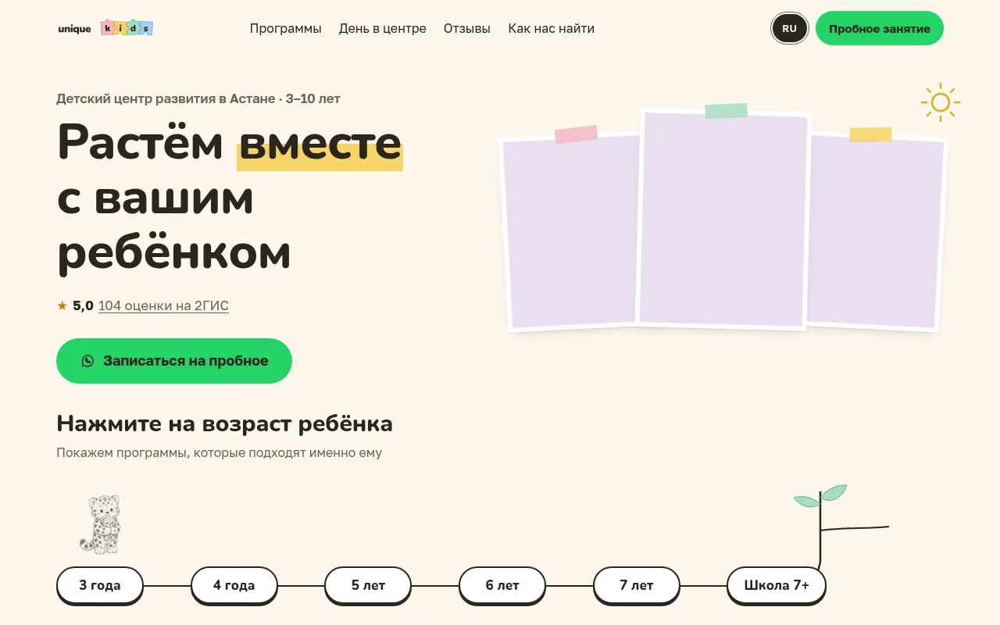

# Unique Kids — сайт детского центра

**Бизнес:** Детский центр развития Unique Kids, Астана.

## Задача
Одностраничный сайт центра на русском и казахском языках: показать программы по возрастам, цены, педагогов и отзывы и дать быстрый способ записаться на пробное занятие.

## Что сделано
- Первый экран, блок «О центре» и «День в центре»
- Программы с фильтром по возрасту ребёнка
- Цены, педагоги, отзывы, галерея
- Пробное занятие и кнопка WhatsApp, закреплённая кнопка записи
- Карта и кнопка «Построить маршрут» в 2ГИС
- Переключатель РУС / ҚАЗ, страница политики конфиденциальности

## Стек
Astro 5, TypeScript, Tailwind CSS 4, шрифты Nunito и Golos Text (Fontsource). Деплой — Cloudflare Workers (статические файлы, Wrangler).

## Демо
https://unique-kids.a-a-studio.workers.dev

## Примечание
В этом репозитории фотографии детей заменены одной нейтральной картинкой-заглушкой, поэтому вид отличается от живого сайта. Скриншот снят с этой версии.

---
Сделано с помощью AI-инструментов (Cursor, AI-агенты) под моим руководством.
